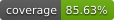

# brfiscal

[](https://pypi.org/project/brfiscal/) [](https://pypi.org/project/brfiscal/) [](https://pypi.org/project/brfiscal/) [](https://github.com/rhenter/brfiscal/actions/workflows/ci.yml) [](https://github.com/rhenter/brfiscal/actions/workflows/ci.yml) [](https://github.com/rhenter/brfiscal)

Tabelas fiscais brasileiras para Python, com **espelho local versionado** das fontes
oficiais, **busca por descrição** e **validação**. Funciona em qualquer projeto Python;
a integração com Django é opcional.

> Status: alpha (0.1). NCM e CEST embutidas. Outras tabelas (CFOP, CST/CSOSN,
> natureza da receita PIS/COFINS, cClassTrib IBS/CBS…) estão no roadmap.

## Por que

Quem cadastra produto ou confere nota de entrada raramente sabe qual NCM ou CEST usar,
e o código errado vira imposto errado. As tabelas oficiais existem, mas estão espalhadas
em portais diferentes, em formatos diferentes, sem API estável. A `brfiscal` traz essas
tabelas para dentro do seu projeto, com data de vigência, e oferece funções simples
para validar e sugerir códigos.

## Instalação

```bash
# com uv
uv add brfiscal              # só Python
uv add "brfiscal[django]"    # com a app Django

# com pip
pip install brfiscal
pip install "brfiscal[django]"
```

## Uso

```python
from brfiscal import ncm, cest

ncm.validar("1905.31.00")                 # True  (8 dígitos e existe na tabela vigente)
ncm.obter("19059090").descricao           # 'Outros'
ncm.obter("19059090").descricao_completa  # 'Produtos de padaria ... > Outros > Outros'
ncm.formatar("19053100")                  # '1905.31.00'

for r in ncm.buscar("creme dental colgate 90g", limite=3):
    print(r.item.codigo_formatado, r.pontuacao, r.item.descricao)
# 3306.10.00 0.9 Dentifrícios (dentífricos)

cest.para_ncm("19053100")                 # todos os CESTs que listam esse NCM
cest.validar_par("19053100", "1705700")   # ValidacaoPar(situacao=..., sugestoes=(...))

ncm.metadados()  # Metadados(vigencia='2026-11-26', ato='Resolução Gecex nº 926/2026', ...)
```

### Importante: a busca **sugere**, não decide

- A busca compara o nome do produto com o texto oficial da NCM (mais uma lista de
  sinônimos de varejo, como "refrigerante" e "mussarela"). Use o resultado como
  sugestão para uma pessoa confirmar.
- Um NCM pode ter **mais de um CEST**. `cest.validar_par` devolve as alternativas
  para o usuário escolher pela descrição do produto.
- A lib não calcula tributo. Alíquotas e regimes dependem de UF, regime do contribuinte
  e legislação que muda; isso fica no seu sistema.

## Espelho local e atualização

Os dados vêm dentro do pacote (`brfiscal/dados/*.json.gz`), com a data de vigência e o
ato legal de origem. Cada versão da lib traz a tabela vigente na data de publicação.
Para atualizar sem esperar uma nova versão:

```bash
export BRFISCAL_DADOS=/var/lib/brfiscal
brfiscal atualizar ncm      # baixa do Portal Único Siscomex
brfiscal atualizar cest     # lê a página do Convênio ICMS 142/2018 no Confaz
brfiscal info               # mostra vigência de cada tabela
brfiscal buscar ncm "papel higienico"
```

Se `BRFISCAL_DADOS` (ou `brfiscal.configurar(caminho)`) tiver um espelho, ele tem
prioridade sobre o embutido.

| Tabela | Fonte oficial | Formato |
| --- | --- | --- |
| NCM | Receita Federal / Portal Único Siscomex | JSON |
| CEST | Convênio ICMS 142/2018 (Confaz), anexos II a XXVI | HTML |

## Django

Suporta Django 4.2 a 6.1 (Python 3.10 a 3.14; Django 6.x exige Python 3.12+).

```python
INSTALLED_APPS = [..., "brfiscal.contrib.django"]
```

```bash
python manage.py migrate
python manage.py brfiscal_carregar            # carrega NCM e CEST do espelho no banco
python manage.py brfiscal_carregar --baixar   # baixa NCM e CEST vigentes antes de carregar
```

Models: `Ncm`, `Cest`, `CestNcm` (NCMs/prefixos de cada CEST) e `VersaoTabela`.
A carga é idempotente: atualiza o que mudou e marca `ativo=False` o que saiu da tabela.

Campos e validadores para os seus models:

```python
from brfiscal.contrib.django.fields import NcmField, CestField
from brfiscal.contrib.django.validators import ValidadorNcmCest

class Produto(models.Model):
    ncm = NcmField()
    cest = CestField(blank=True)

    def clean(self):
        ValidadorNcmCest()(self.ncm, self.cest)
```

## Roadmap

- [x] NCM com hierarquia, descrição completa e vigência
- [x] CEST: importação dos anexos II a XXVI do Convênio 142/2018
- [ ] CFOP, com conversão saída → entrada (5102 → 1102)
- [ ] CST/CSOSN de ICMS, CST de PIS/COFINS e IPI
- [ ] Natureza da receita PIS/COFINS (tabelas 4.3.x do SPED), ligada ao NCM
- [ ] cClassTrib e CST de IBS/CBS (reforma tributária)
- [ ] cBenef por UF, enquadramento do IPI, código ANP, unidades de medida
- [ ] Busca melhor: base de exemplos "nome do produto → NCM" contribuída pela comunidade

## Desenvolvimento

O projeto usa [uv](https://docs.astral.sh/uv/):

```bash
make deps      # uv sync: cria o .venv com as dependências de desenvolvimento
make test      # pytest
make lint      # ruff
make release   # build, twine check, tag com a versão do CHANGELOG.md e upload no PyPI
```

A versão do pacote vem do primeiro `## X.Y.Z` do `CHANGELOG.md` (`make version` mostra).

Veja [CONTRIBUTING.md](CONTRIBUTING.md).

## Aviso

Os dados vêm de publicações oficiais, mas podem estar desatualizados ou conter erros
de conversão. Confira sempre com a legislação e com sua contabilidade. Licença MIT,
sem garantias.
